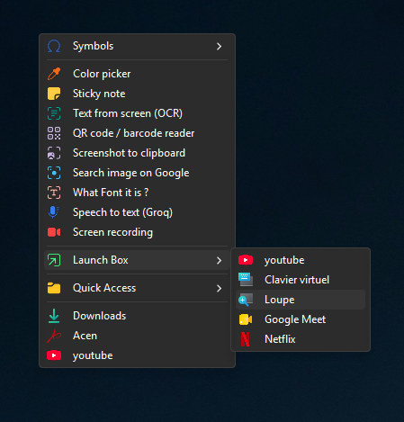
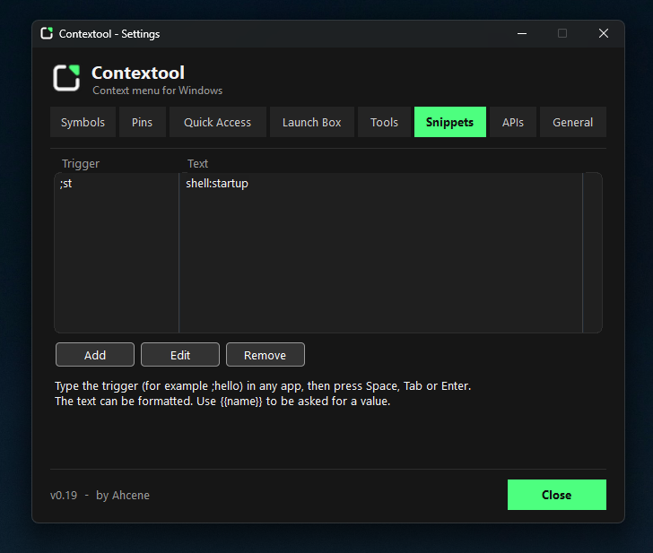

# Contextool

**A free, customizable pop-up menu for Windows 11, built with AutoHotkey.**
Press one shortcut anywhere and get a menu that looks like the native Windows context menu (and follows your dark/light theme) with your symbols, tools, apps, folders and text snippets one click away.

--

## Features

### The menu
- Looks and behaves like the native Windows 11 context menu, and adapts to your Windows theme (dark or light)
- Opens with a keyboard shortcut (default: `Ctrl+Shift+F9`), which you can change in the settings. Handy to assign to an extra mouse button.
- Re-pressing the shortcut elsewhere moves the menu to the new position

### What's inside
- **Symbols**: a sub-menu of your favorite characters (É, •, ■, Œ...). One click inserts the symbol at your text cursor.
- **Quick Access**: your favorite folders, with their original icons
- **Launch Box**: your favorite apps and files, with their original icons
- **Pins**: pin anything and place the group where you want in the menu
- **Snippets**: reusable text (with variables), triggered from the keyboard
- **Tools** (each can be enabled, disabled and reordered):
  - **Color picker**: left click = HEX code, `Ctrl` + click = CMYK, right click = open the color in Coolors
  - **Sticky notes**: movable, resizable, always on top, as many as you like, saved until you delete them. They follow the Windows theme, support a to-do mode (checkboxes, strikethrough) and can be collapsed into a small draggable icon.
  - **Screen OCR**: select an area, get the text in a popup, copy it or not
  - **QR code / barcode reader**: select an area, read the content, copy it or not
  - **Clipboard-only screenshot**: capture an area straight to the clipboard, nothing saved to your Screenshots folder
  - **Reverse image search**: select an area and search it with Google Lens
  - **Font identifier**: select an area containing text and identify the font (uses the WhatFontIs API, free personal key required)
  - **Voice dictation**: speak and the text is typed for you (uses Groq Whisper, free API key required)

### Settings
- Opened from the tray icon
- Add, remove, rename and reorder symbols, folders, apps, tools and pins
- API keys are stored masked and encrypted with Windows
- **Backup tab**: save, restore from a file, or reset everything

---

## Installation

### Option 1: with AutoHotkey (recommended)
1. Install [AutoHotkey v2](https://www.autohotkey.com/)
2. Download `Contextool.ahk` from the [latest release](../../releases/latest)
3. Double-click it. A tray icon appears.
4. Press `Ctrl+Shift+F9` to open the menu

### Option 2: standalone `.exe`
Download `Contextool.exe` from the [releases page](../../releases/latest). No AutoHotkey needed.
> Windows SmartScreen or your antivirus may warn about unsigned AutoHotkey executables. The full source code is in this repository so you can check it or compile it yourself.

### Start with Windows
Put a shortcut to the script in your Startup folder (`Win+R`, type `shell:startup`, press Enter).

---

## Where are my settings stored?

Everything lives in `Documents\AHK SETTINGS\Contextool`. Only the script itself sits where you put it, so updating means just replacing the script file. Your settings and notes stay safe.

---

## Optional API keys

Two tools need a free personal key. Paste it in the **APIs** tab of the settings (never in the code):

| Tool | Service |
|------|---------|
| Font identifier | [WhatFontIs](https://www.whatfontis.com/) |
| Voice dictation | [Groq](https://console.groq.com/) |

Everything else works with no account and no key.

---

## Requirements
- Windows 11 (designed for it; may partly work on Windows 10)
- AutoHotkey v2, unless you use the `.exe`

## License
MIT. Free to use, modify and share. See [LICENSE](LICENSE).

## Author
Made by Ahcene. Feedback, bug reports and ideas are welcome in the [Issues](../../issues) tab.
